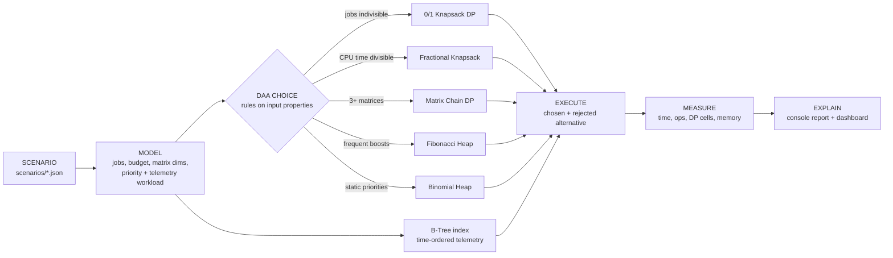

# ThermoSched: Thermal-Aware CPU Workload Optimization Framework

**Design and Analysis of Algorithms: Framework Assignment 2** · Group 11 · AI&ML Panthers

| Member | Roll No. |
|---|---|
| M. Pranay Kumar Reddy | 25WU0102138 |
| K. Devi Srikar | 25WU0102123 |
| K. Shreenanadh | 25WU0102119 |

A compute server receives matrix-processing, analytics and other heavy jobs. When too many expensive
jobs run together, CPU temperature rises and the processor throttles. Software cannot cool the CPU.
What it **can** do is reduce avoidable computation and choose which work runs under a limited
thermal budget. ThermoSched does this using only DAA syllabus techniques, and it **changes its
choice of algorithm when the properties of the workload change**.

> Design boundary: ThermoSched does not claim to cool the CPU. It shows how algorithmic choices
> reduce or reorganise computational work, which can reduce thermal pressure in a real system.

---

## 1. Problem abstraction

| Real-world entity | Model | Size parameter |
|---|---|---|
| CPU job | item with `benefit` (useful output) and `thermal_cost` (heat / CPU load) | `n` jobs |
| Thermal headroom of the server | knapsack capacity `W` | `W` budget units |
| Matrix-processing pipeline A1 x A2 x ... x An | chain of matrix dimensions `p0..pn` | `n` matrices |
| Run queue with changing priorities | min-priority queue, key = urgency | `n` queued jobs |
| Historical thermal telemetry | ordered index, key = timestamp | `n` records |

**Objective:** maximise total benefit of admitted work, minimise scalar multiplications, and keep
priority and telemetry operations cheap.
**Constraint:** total thermal cost of admitted work ≤ `W`.

---

## 2. Framework architecture



The rules look at **properties of the input**, never at algorithm names supplied by the user:

| Decision | Property inspected | Choice | Rejected alternative |
|---|---|---|---|
| Job admission | `jobs_divisible = false` | 0/1 Knapsack (DP) | Greedy by ratio (not optimal) |
| Job admission | `jobs_divisible = true` | Fractional Knapsack (Greedy) | 0/1 DP (slower, lower benefit) |
| Computation order | chain has ≥ 3 matrices | Matrix Chain Multiplication (DP) | Left-to-right order |
| Computation order | chain has < 3 matrices | Direct multiplication | MCM DP (nothing to optimise) |
| Run queue | frequent **boost** updates (job jumps to the front) | Fibonacci Heap | Binomial Heap |
| Run queue | no / small updates | Binomial Heap | Fibonacci Heap |

The 0/1 path also has a modelling step: all costs and the budget are divided by their **GCD**, which
gives the same answer with a smaller DP table (the peak-hours scenario shrinks W from 50 to 10).

The **telemetry index is always a B-Tree** (t = 3); there is no switch, because the data's shape
decides it. Readings are keyed by timestamp (ordered keys), we ask for time ranges such as "the last
10 minutes" (which a hash table cannot answer), the log is append-only (no deletion needed), and wide,
shallow nodes mean few block reads when the log is stored on disk.

---

## 3. Adaptation demo: same jobs, different conditions

The two bundled scenarios use **the same five jobs** and the same budget (50). Only the
conditions change:

| Module | `peak_hours.json` | `night_batch.json` |
|---|---|---|
| Job admission | indivisible → **0/1 Knapsack**: J2 + J3, benefit **220** (greedy would give 190) | divisible → **Fractional**: J1, J2, ⅔ of J3, benefit **240** |
| Computation | 4 matrices → **MCM**: `((A1A2)(A3A4))` = 5,000 vs 10,500 multiplications (**−52.4 %**) | 2 matrices → **direct** |
| Run queue | 1 boost per dispatch → **Fibonacci**: 117,028 ops vs 217,285 | no updates → **Binomial**: 171,800 ops vs 235,312 |
| Telemetry | **B-Tree**: height 9, 8.5 nodes and 16.6 comparisons per search, last 10 min = 120 readings | same B-Tree (no switch needed) |

---

## 4. Complexity analysis

| Technique | Time | Space | Correctness argument |
|---|---|---|---|
| 0/1 Knapsack (bottom-up DP) | O(n·W) | O(n·W) (full table kept for trace-back) | Optimal substructure: the best answer for (i, w) either skips job i or takes it, so `dp[i][w] = max(dp[i-1][w], dp[i-1][w-c_i] + b_i)` |
| Fractional Knapsack (greedy) | O(n log n) | O(n) | Greedy-choice property: with divisible items, an optimal answer always contains as much as possible of the highest benefit/cost item (exchange argument) |
| Matrix Chain Multiplication | O(n³) | O(n²) | Optimal substructure: the last multiplication splits the chain at some k, and both halves must be bracketed optimally |
| Binomial Heap | insert, extract-min, decrease-key, union: **O(log n) worst case** | O(n) | Each tree B_k has 2^k nodes, so there are at most ⌊log n⌋ + 1 trees and height ≤ log n |
| Fibonacci Heap | insert, decrease-key, union **O(1) amortized**, extract-min **O(log n) amortized** | O(n) | Potential = roots + 2·marked nodes. Cascading cuts keep a node of degree k with at least F(k+2) descendants, so the maximum degree is O(log n) |
| B-Tree (min degree t) | search / insert O(t · log_t n), range O(t · log_t n + k) | O(n) | Every node except the root holds t−1..2t−1 keys and all leaves are at the same depth, so height ≤ log_t((n+1)/2) |

**Polynomial vs pseudo-polynomial.** Fractional Knapsack, Matrix Chain and all heap and tree
operations are polynomial in the input size. 0/1 Knapsack DP is **pseudo-polynomial**: its O(n·W)
running time grows with the *numeric value* of W, not with the number of bits needed to write W
down. Doubling the precision of the thermal budget doubles the work even when the number of jobs
stays the same. The GCD scaling step exists for this reason.

---

## 5. Experiments (`python main.py`)

All numbers below were measured on the development machine (Python 3.14, best of 3 runs). The
CSV files are in [`results/`](results), and the dashboard plots them.

**0/1 Knapsack scales with the DP table, not just with n** (n = 200 jobs):

| W | DP cells | 0/1 DP time | Peak memory | Fractional time |
|---|---|---|---|---|
| 100 | 20,301 | 1.8 ms | 278 KiB | 0.03 ms |
| 1,000 | 201,201 | 23.3 ms | 2,675 KiB | 0.05 ms |
| 5,000 | 1,005,201 | 107.5 ms | 13,448 KiB | 0.03 ms |

A 49.5× larger table took about 60× longer and used 48× more memory. Growth is linear in n·W, as
predicted. The greedy method's cost does not depend on W at all.

**Greedy is unsafe for indivisible jobs** (300 random difficult instances per size):

| n | Greedy not optimal | Average loss when wrong |
|---|---|---|
| 5 | 21.7 % | 10.08 % |
| 10 | 36.0 % | 3.38 % |
| 20 | 47.7 % | 1.54 % |
| 40 | 61.7 % | 0.57 % |

**Matrix Chain DP work is exactly (n³ − n)/6 inner steps** (n = 160 → 682,640 steps, ~90 ms).
Work saved over the left-to-right order ranged from 0.5 % to 92.6 %, depending on matrix shapes.

**Heaps, 20,000 jobs** (ops = key comparisons + pointer changes):

| Workload | Binomial ops | Fibonacci ops | Winner (ops) |
|---|---|---|---|
| no priority updates | 825,301 | 1,121,172 | Binomial |
| 4 small "aging" updates / dispatch | 914,882 | 1,276,598 | Binomial |
| 1 "boost" to the front / dispatch | 1,042,411 | 511,932 | **Fibonacci (−51 %)** |
| 4 boosts / dispatch | 1,021,986 | 1,054,581 | about equal |

**B-Tree telemetry index (t = 3), time-ordered inserts:**

| n | Height (levels) | Bound log_t((n+1)/2) + 1 | Nodes / search | Comparisons / search | Splits |
|---|---|---|---|---|---|
| 1,000 | 6 | 6.66 | 5.52 | 11.22 | 491 |
| 10,000 | 8 | 8.75 | 7.53 | 15.72 | 4,988 |
| 50,000 | 10 | 10.22 | 9.49 | 18.87 | 24,984 |

50× more readings add only 4 levels: logarithmic growth.

### Theory vs observation

* **Fibonacci heaps are not always faster.** Their O(1) amortized decrease-key only pays off when a
  decrease would make a Binomial heap bubble a key all the way up. For small "aging" nudges the
  Binomial bubble-up stops after about one comparison, so its O(log n) bound is rarely reached, and
  the Fibonacci heap's extra bookkeeping (cuts, marks, larger root lists) costs more. This is why
  the framework looks at the **kind** of update, not only how many there are.
* Wall-clock times in Python follow the operation counts only loosely, because interpreter overhead
  per function call is large. Operation counts are the fairer comparison, which is why both are
  reported.
* **The B-Tree sits close to its height bound.** Time-ordered inserts always go into the right-most
  leaf, and each split leaves the left node half full (2 of 5 keys). So there are about n/2 splits
  (24,984 for 50,000 readings), and the height (10) is near the worst-case bound (10.22) rather than
  the best case. Each search visits about one node per level but makes about two comparisons per node,
  because it scans the keys inside each node.

### Gaps in these algorithms that led to newer ones

| Gap observed | Newer algorithm / structure |
|---|---|
| Fibonacci heap's large constants in practice | Pairing heap (Fredman, Sedgewick, Sleator, Tarjan, 1986), rank-pairing heaps |
| O(n·W) table for 0/1 knapsack is huge for fine-grained budgets | Value-scaling approximation schemes, meet-in-the-middle for small n |
| Matrix Chain DP is O(n³) | Hu–Shing algorithm, O(n log n) |
| B-Tree range scans must climb back up the tree | B+ Tree (linked leaves), used by most databases |
| Sequential inserts leave B-Tree nodes half full | Bulk loading / right-most split optimisation in database B+ Trees |
| Write-heavy telemetry causes many node splits | LSM-Trees, used in time-series databases |

---

## 6. Tests (`python -m unittest discover -s tests -v`)

**35 tests, all passing**, in four families:

| Family | Examples |
|---|---|
| Normal | sample jobs → 220 / 240; CLRS matrix chain → 15,125; heap sort output |
| Boundary | budget 0, no jobs, job heavier than the budget, exact fit, one/two matrices, empty heap/tree, rejecting an increase-key, the first B-Tree root split |
| Large | 200 jobs × W=2000 bounds check, 101-matrix chain, 20,000-element heap sort, 30,000-key B-Tree with invariant checks |
| Difficult | DP vs brute force on 150 random instances, equal ratios, random mixed heap operations checked against a dictionary, 20,000 time-ordered (sorted) inserts into the B-Tree, B-Tree range query vs a sorted list |

Adaptation tests check that the framework picks different techniques for the two scenarios, and that telemetry always uses the B-Tree.

---

## 7. How to run

Requires **Python 3.8+**. Only the standard library is used, so there is nothing to install.

```bash
python main.py                                      # both scenarios + all experiments + dashboard data
python main.py --scenario scenarios/peak_hours.json # explain one scenario
python -m unittest discover -s tests -v             # run the 35 tests
```

Then open **`dashboard/index.html`** in a browser. It reads `dashboard/data.js`, which `main.py`
writes, so it works without a server. The page shows a live, *simulated* CPU thermal view
(unmanaged vs ThermoSched admission) and animated versions of every comparison: job blocks moving
between the budget and the waiting queue, the two matrix-multiplication orders racing, a boosted
job bubbling up a Binomial heap vs being cut in a Fibonacci heap, and a B-Tree search followed by a
time-range scan.
All algorithm numbers on the page come from the Python run. To try your own conditions, copy a file in `scenarios/` and
change `jobs_divisible`, `matrix_pipeline` or `update_kind`.

## 8. Project structure

```
main.py                     entry point: run scenarios, experiments, export dashboard data
scenarios/                  scenario inputs (peak_hours.json, night_batch.json)
thermosched/
  models.py                 Job entity, scenario loader, random job generator
  knapsack.py               0/1 Knapsack DP, Fractional Knapsack greedy, greedy baseline
  matrix_chain.py           Matrix Chain Multiplication DP + bracketing
  binomial_heap.py          Binomial Heap (insert, extract-min, decrease-key, merge)
  fibonacci_heap.py         Fibonacci Heap (lazy insert, cuts, cascading cuts)
  btree.py                  B-Tree telemetry index (insert with split, search, range query)
  workloads.py              run-queue and telemetry simulators (same sequence for both structures)
  framework.py              SCENARIO → MODEL → CHOICE → EXECUTE → MEASURE → EXPLAIN
  experiments.py            scaling experiments
tests/                      unittest suites (normal / boundary / large / difficult)
results/                    CSV output of the experiments
dashboard/                  index.html + generated data.js
```

## 9. Limitations

* Thermal cost is a modelled number per job, not read from hardware sensors. The dashboard's
  temperature view is a simple simulation driven by the admitted thermal cost.
* Admission handles one resource (the thermal budget). Adding more constraints, such as memory or
  deadlines at the same time, needs a richer model than a single knapsack.
* Heap and tree comparisons count operations in Python. Absolute times would differ in C or Java,
  but the growth trends would not.
* Telemetry is treated as an append-only log, so tree deletion is not implemented.
